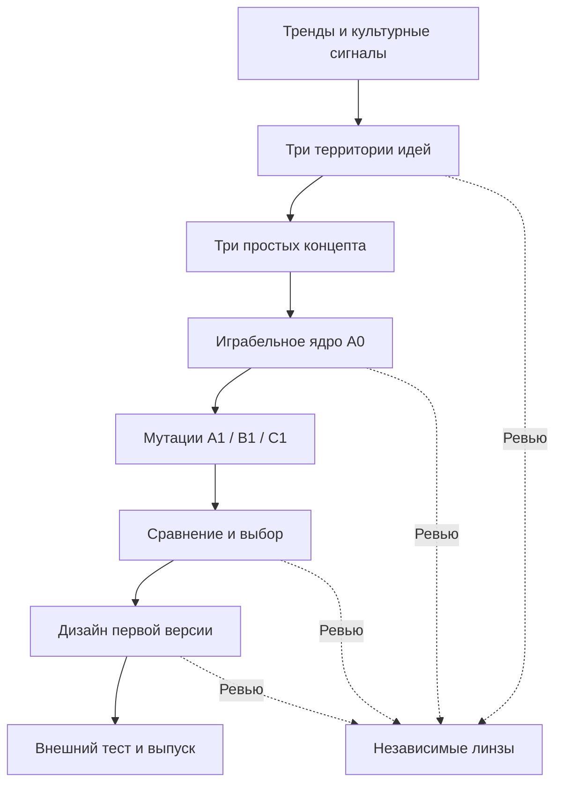

# Game Idea Factory

Агентский конвейер поиска, синтеза и последовательной разработки **дизайна новой казуальной игры**. От наблюдения за мемом или игровым действием — к подтверждаемой идее, играбельному ядру, осмысленным мутациям механики и подготовке проекта к выпуску.

**Состояние:** структура и регламенты готовы к первому пилотному прогону. Конкретная игра, аудитория, платформа, бюджет и концепт пока **не выбраны**. Тренд-радар не запущен по расписанию; результаты исследований не считаются результатами пилота.

## Как это работает



Каждый содержательный этап **G0–G11** заканчивается понятной карточкой решения пользователя. Агент самостоятельно выполняет согласованную работу между такими точками. Согласие не выводится из молчания, кнопки в локальном макете или заключения субагента.

## Быстрый вход для агента

1. Прочитать [AGENTS.md](AGENTS.md), затем [state.md](state.md).
2. Изучить [этапы и условия перехода](docs/PIPELINE.md), [маршруты](docs/ROUTES.md), [ревью](docs/REVIEW_PROTOCOL.md) и [утверждения](docs/APPROVALS.md).
3. Выполнить [проверку возможностей среды](docs/PILOT_RUNBOOK.md#2-предполетная-проверка).
4. Для нового прогона запустить:

   ```bash
   python3 tools/pipeline.py init --run pilot-20261111-01 --through G2
   python3 tools/pipeline.py status --run pilot-20261111-01
   python3 tools/pipeline.py audit --run pilot-20261111-01
   ```

5. Показать пользователю материал G0 и получить конкретный выбор. Пилот **не выбирает платформу или игру за пользователя**.

Подробная последовательность пилота, включая контрольные ожидания, описана в [PILOT_RUNBOOK.md](docs/PILOT_RUNBOOK.md). Команды `init`, `status` и `audit` не запускают исследования, генерацию, рекламу или публикацию.

## Структура

| Путь | Назначение |
|---|---|
| `AGENTS.md` | Главный маршрут и обязательные ограничения агента |
| `state.md` | Проектный статус и точка возобновления |
| `docs/PIPELINE.md` | Этапы G0–G11, входы, выходы, решения |
| `docs/ROUTES.md` | Специализации, маршрутизация, handoff и волны |
| `docs/RESEARCH_PROTOCOL.md` | Тренд-радар, достоверность и синтез |
| `docs/REVIEW_PROTOCOL.md` | Субагенты с независимыми линзами и уровни критичности |
| `docs/APPROVALS.md` | Формат наглядных утверждений и доказательства согласия |
| `docs/PILOT_RUNBOOK.md` | Пошаговый запуск следующего пилота |
| `docs/CLI.md` | Команды, версии пакетов, возвраты и сохранение прогонов |
| `agents/` | Задания рабочих агентов и независимых ревьюеров |
| `config/routes.json` | Машинная карта ведущих агентов, инструкций и обязательных линз |
| `docs/research/` | Исходное discovery со ссылками на первоисточники |
| `schemas/` | Контракты JSON для сигналов, свидетельств, решений и ревью |
| `templates/` | Карточки этапов, концептов, тестов, полного дизайна |
| `tools/pipeline.py` | Локальный реестр прогонов и проверка переходов |
| `tests/` | Проверки блокировок и форматов |
| `runs/` | Рабочие прогоны; создаются командой `init` и не коммитятся автоматически |

CLI — исполняемый реестр, валидатор и диспетчер инструкций. Реальные поиск, синтез, вызовы субагентов и создание прототипа выполняет агентская среда по этим инструкциям. Код не требует ключа конкретного LLM-провайдера и не выдаёт локальную проверку за реальный агентский пилот.

Перед сменой среды сохраните всю папку активного run в постоянное приватное хранилище: она исключена из Git и содержит ответы пользователя, материалы и историю. Правила восстановления и очищенного публичного handoff — в [CLI.md](docs/CLI.md#память-и-восстановление).

## Проверки проекта

```bash
python3 -m unittest discover -s tests -v
python3 tools/pipeline.py check-repo
```

Требуется только Python 3.10+ со стандартной библиотекой. Для фактических генераций и игровых прототипов набор доступных инструментов проверяется отдельно; Godot, Blender, удалённый рабочий стол и сервисы изображений не считаются подключёнными по умолчанию.

Перед публикацией выполнены **27 тестов**, проверки 12 маршрутов и 8 схем, а также независимое ревью архитектуры, доказательности и геймдизайна. Найденные проблемы и границы проверки: [bootstrap-review.md](docs/reviews/bootstrap-review.md). GitHub Actions повторяет проверки при изменениях.

## Основные принципы

- Известный мем и высокий просмотр ролика — **гипотеза интереса**, а не доказанный спрос на игру.
- Первое играбельное ядро A0 обязательно предшествует масштабному производству.
- Одно изменение существенного правила — одна сравниваемая ветка; A0 остаётся доступной для отката.
- Важные этапы G1, G3, G5, G9 и G11 требуют нескольких **независимых субагентских ревью**, каждое со своей линзой.
- Заключение субагента и выбор пользователя фиксируются раздельно. Неразрешённые блокирующие замечания останавливают переход.
- Интерактивная карточка помогает выбрать вариант, но факт утверждения фиксируется только из настоящего ответа пользователя.
- Время и средства на внешние эксперименты, публикацию и рекламу задаются отдельно в соответствующих решениях.

Это самостоятельная фабрика идей. При последующей передаче утверждённого дизайна в `game-factory` или другую производственную систему нужен явный handoff со всей актуальной памятью.
